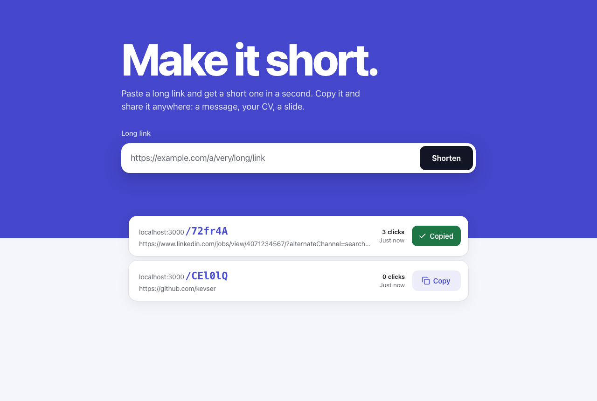

# Link shortener

Paste a long link, get a short one, and see how many times it was opened.

**Live:** _coming soon_



## Stack

| Part | Tech | Hosted on |
|---|---|---|
| Frontend | React 19, TypeScript, Vite, plain CSS | Vercel |
| Backend | Node.js 22, Express 5, TypeScript | Render |
| Database | PostgreSQL on Neon, Drizzle ORM + migrations | Neon (Frankfurt) |

## How it works

- `POST /shorten` checks the URL (only `http`/`https`), picks a random 6-character code and stores it. If the code is taken, the database rejects the insert and it tries another.
- `GET /:code` adds a click and returns the destination in **one SQL statement**, then redirects with `302`. Two visits at the same moment can't lose a click.
- `GET /links?codes=…` returns fresh click counts for the links a browser has saved.
- The frontend keeps "Your links" in `localStorage`, since there are no accounts yet, and refreshes click counts when you come back to the tab.

## Run it locally

You need Node 22 and a Neon database.

```bash
cd backend
npx neon@latest env pull   # writes DATABASE_URL and DATABASE_URL_UNPOOLED to .env.local
npm install
npm run db:migrate
npm run dev                # http://localhost:3000
```

```bash
cd frontend
npm install
npm run dev                # http://localhost:5173
```

## What I learned

- REST basics: routes, methods, status codes (`201`, `302`, `400`, `404`, `500`)
- CORS, and why the browser enforces it but curl doesn't
- Validating input before trusting it (blocking `javascript:` links)
- Pooled vs direct database connections, and schema migrations as code
- Deploying a frontend and backend separately and connecting them with environment variables

Design decisions are in [DESIGN.md](DESIGN.md).
